<div align="center">

# MehulK Workstation v20.0

**One command turns a fresh Fedora Workstation into a fast, good-looking, keyboard-first GNOME desktop, and keeps it that way.**
Coming from Windows or macOS? You'll feel at home in minutes: a Finder menu, a Mac-style dock, Windows-style snapping and screenshots.


-blue?logo=gnome)
[](https://github.com/MehulK-techie/fedora-workstation-config/actions/workflows/shellcheck.yml)


[Start here](#start-here-3-minutes) · [What's new](#whats-new-in-v200) · [Cheat sheet](#cheat-sheet) · [Beginner's guide](#beginners-guide-and-troubleshooting) · [All features](docs/FEATURES.md) · [Guide](docs/GUIDE.md) · [Reference](docs/REFERENCE.md)

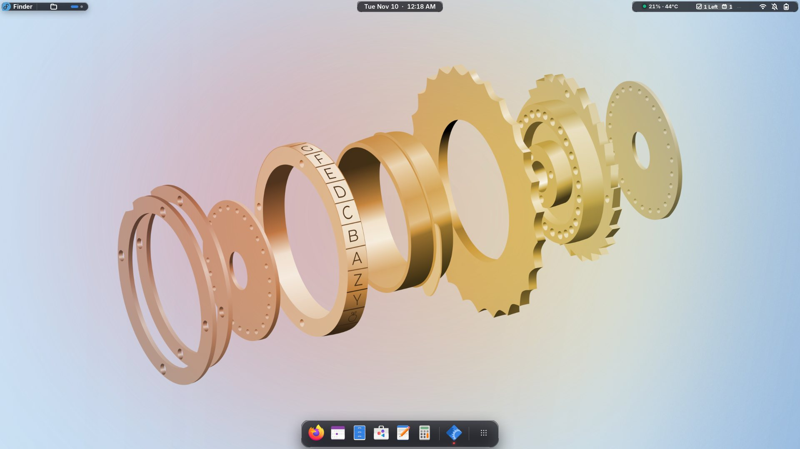

<sub>MehulK Workstation v20.0 on GNOME 51. Wallpaper: GNOME's default.</sub>

</div>

---

## Start here (3 minutes)

**New install.** On a fresh Fedora Workstation, open the Terminal app and paste:

```bash
sudo dnf install -y git && git clone https://github.com/MehulK-techie/fedora-workstation-config.git ~/fedora-workstation-config && cd ~/fedora-workstation-config && sudo ./setup.sh
```

Log out and back in when it finishes: that's it. (`setup.sh` installs the apps and drivers as root, then runs `sync.sh` as you to set up the desktop.)

**Already using it? Upgrade** to the latest, any time:

```bash
cd ~/fedora-workstation-config && git pull && ./sync.sh
```

`sync.sh` is safe to run as often as you like: it never duplicates anything and keeps your own changes. The first run on an account (no `~/.config/mk-workstation/.initialized` yet) is a fresh install: it turns on exactly MK's seven extensions (every other one off) and applies MK's desktop settings, theme and shortcuts. Every run after that is an update: MK's code, extensions and their schemas are refreshed and shortcuts MK has added since are set, and nothing you changed is touched: extension switches, settings, wallpaper, keys. `./sync.sh --reset-defaults` puts MK's defaults back (each sync's settings snapshot undoes it: `mk restore`). It also makes the folders MK uses (Pictures/Screenshots, Videos/Wallpapers, ~/.config/mk) and ends by naming any package MK needs that isn't installed yet; `./sync.sh --check-deps` does just that check. Nothing in the repo is tied to one account: personal paths are stored as `__USER_HOME__` and filled in for whoever runs it. It updates MK's apps, extensions, audio rules and new shortcuts. New system packages come from `sudo ./setup.sh`, which is safe to run again too.

---

## What's new in v20.0

| | |
| :---: | :---: |
| 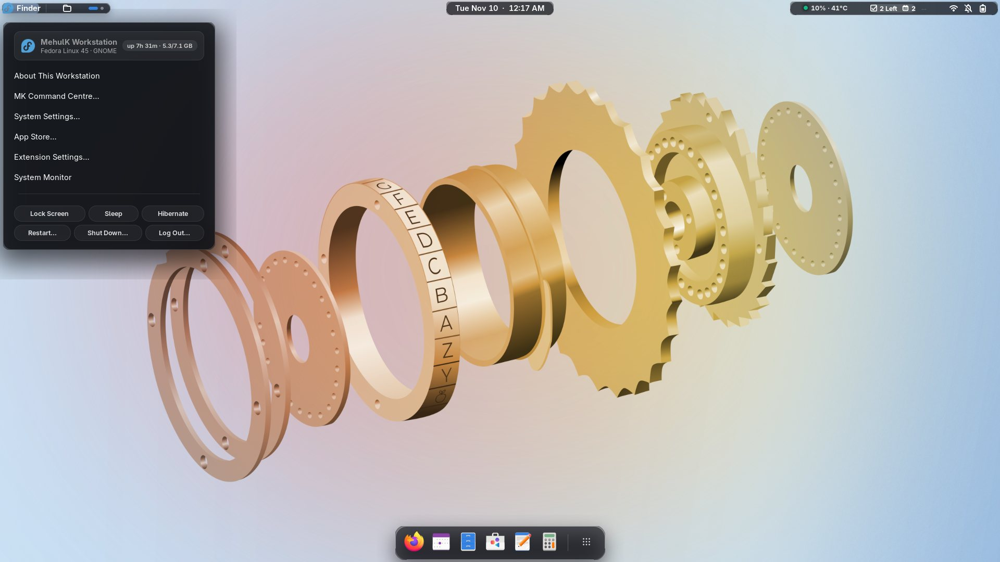<br><sub>**Finder menu**: a plain list (About, Command Centre, Settings, App Store, Extensions, System Monitor, then Sleep, Hibernate, Restart, Shut Down, Log Out), each with its keyboard shortcut on the right</sub> | 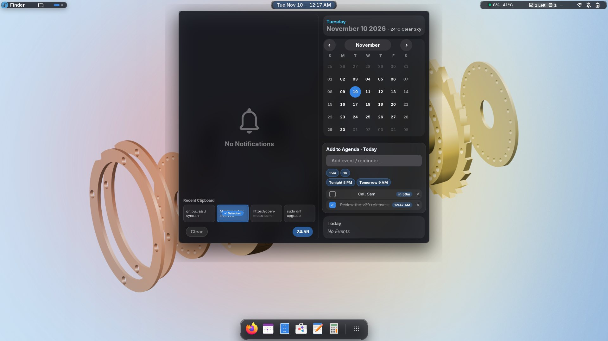<br><sub>**Click the clock**: weather by the date, a clipboard shelf that never reshuffles, a daily checklist, Focus 25m</sub> |
| 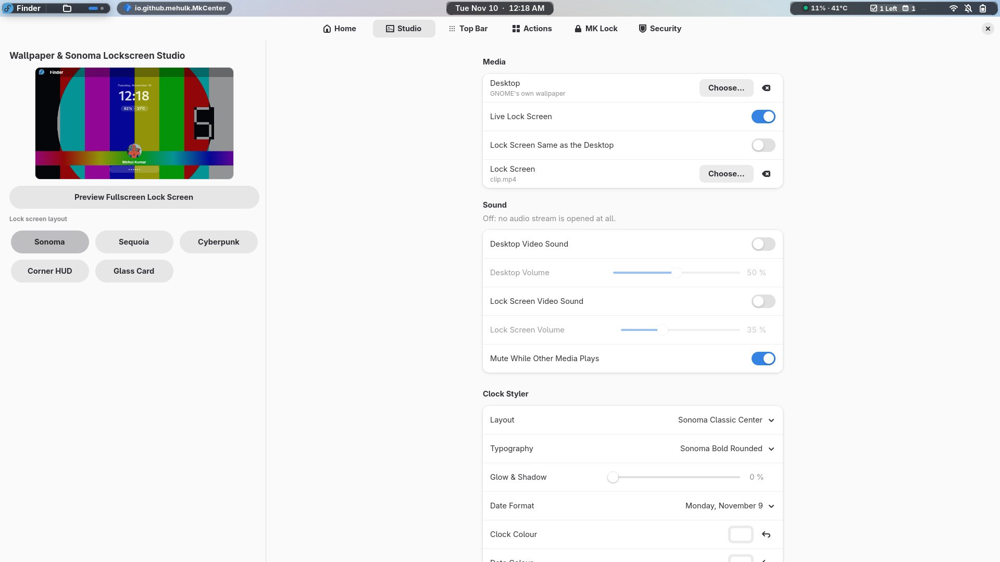<br><sub>**MK Command Centre**: a live preview that stays beside every setting (lock screen, wallpaper, logo, dock glow)</sub> | 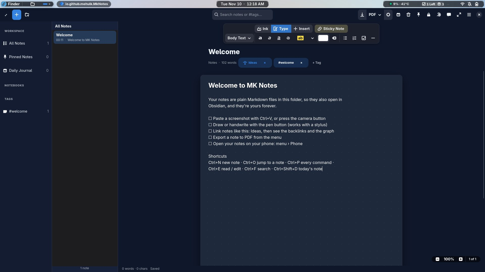<br><sub>**MK Notes**: Google Docs-style flow, pictures move with your text, one Ctrl+Z for everything, exact PDFs</sub> |

- **Top bar:** one frosted glass capsule (round logo, Places, your workspaces) and the app you're in beside it; a steady stats pill (CPU and temperature) that never jiggles the bar.
- **Lock screen:** a Sonoma-style clock over a live video or picture, five layouts, a tagline and the battery and weather in one pill right under the time, inside a centred glass card, "Click or press a key to unlock" only after you move the mouse, and a round power button whose Sleep, Hibernate, Restart and Shut Down go straight to the system (they work while locked).
- **Weather everywhere:** Open-Meteo (no account, no key), for where you are; the last reading shows at once after a reboot.
- **Screenshots like Windows:** PrtSc takes the whole screen at once (saved and copied); Super+Shift+S, drag an area, and it's taken the moment you let go. The notification has Open Viewer, Annotate Markup and Delete.
- **Dock:** only the icon under the pointer grows, the app you're in sits raised on a soft tile in the glow colour you pick (Spider-Red by default).
- **Speakers:** a B&O-style tuning built into PipeWire for the laptop's own speakers (warmer bass, clearer voices, wider stereo); headphones are left alone. `mk sound bo status`.
- **Live wallpaper:** decoded on the graphics card and capped at 30 fps so the dock and top bar stay smooth; edge to edge, under the top bar and the dock to the bottom of the screen; menus never pause it. Its volume slider sits in Quick Settings right under the speaker's, while the wallpaper is a video with sound. By default it plays (with its sound) only on the clean desktop: open an app and it fades out and pauses, using no CPU at all, then picks up again when you're back on the desktop. Turn on **Wallpaper Bg Play** in Quick Settings to keep it playing under your apps; it then fades out by itself while YouTube, Spotify or anything else plays, and comes back when they stop.
- **Dock:** optional frosted glass behind each icon (Command Centre › Dock); the top bar always shows; the dock shows on a clean desktop and gets out of the way when a window overlaps it, with one of four animations you pick in Command Centre (the bottom edge of the screen brings it back), in place, over the live wallpaper.
- **Workspaces:** switching slides your windows over the live wallpaper, which stays put and keeps playing.
- **Dynamic Island:** volume, brightness, a new song or a timer ending show in the clock's capsule, which widens for a moment and settles back.
- **Deep Focus (Super+Alt+F):** notifications off, wallpaper paused, dock tucked away and a 50-minute focus session; press again and everything comes back.
- **Wallpaper palette:** the top bar's glass, the Dynamic Island and the dock's edge take on a quiet tint from your wallpaper (with `mk accent auto`).
- **Photo Booth:** 43 live looks including AR (hearts that burst from your hands, a crown, halo, cat or bunny ears, pixel shades, a thought cloud) and real frames (Polaroid, 4-cut strip, 35mm film, comic panel, neon HUD, gallery matte), fullscreen with F11.

## Cheat sheet

| Do this | Press |
| :--- | :--- |
| Screenshot of the whole screen (saved and copied) | `PrtSc` |
| Screenshot of an area (taken as you let go) | `Super+Shift+S` |
| Snap a window left / right · maximize · restore | `Super+←` / `Super+→` · `Super+↑` · `Super+↓` |
| Lock the screen | `Super+L` |
| Every shortcut, live and editable | `Super+/` |
| Notes · Companion (tasks, reminders) | `Super+N` · `Super+Shift+N` |
| Add a reminder from anywhere | `Super+Alt+A` |
| Clipboard history · emoji | `Super+V` · `Super+.` |
| Next wallpaper (contour-trace transition) | `Super+W` |
| Photo Booth | `Super+C` |
| Switch apps · all windows | `Super+Tab` · `Alt+Tab` |

The full table is under [Keyboard shortcuts](#keyboard-shortcuts).

---

## A look around

| | |
| :---: | :---: |
| 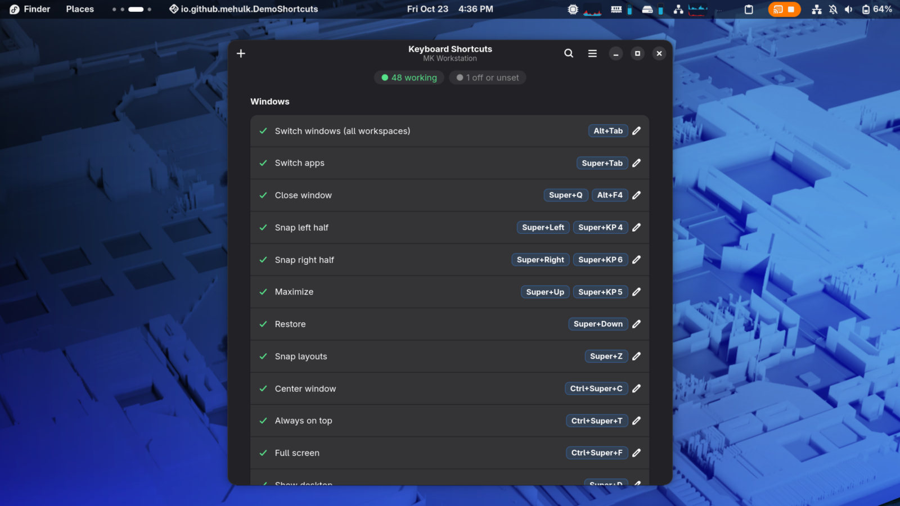<br><sub>Super+/ · every shortcut, live, editable</sub> | 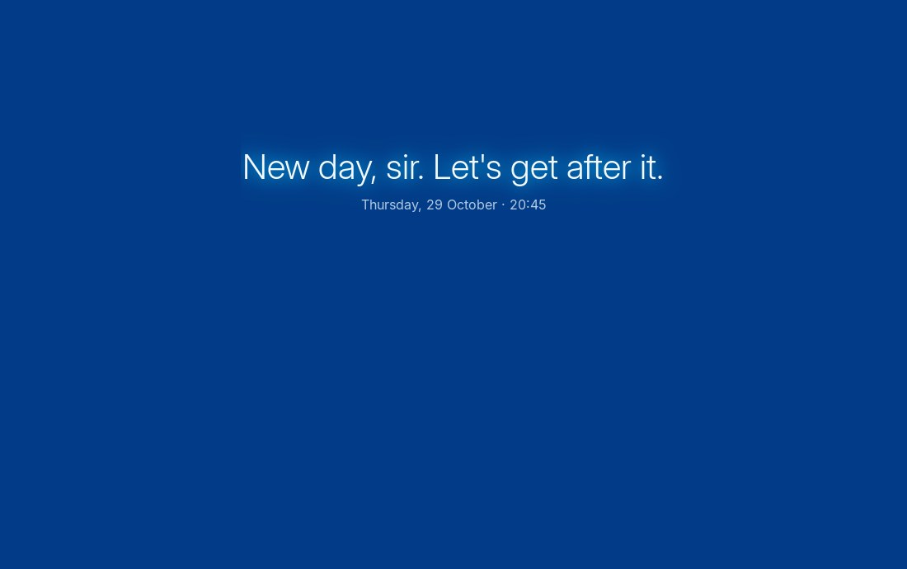<br><sub>Super+N · MK Notes: A4 pages, real tables, rich text</sub> |
| 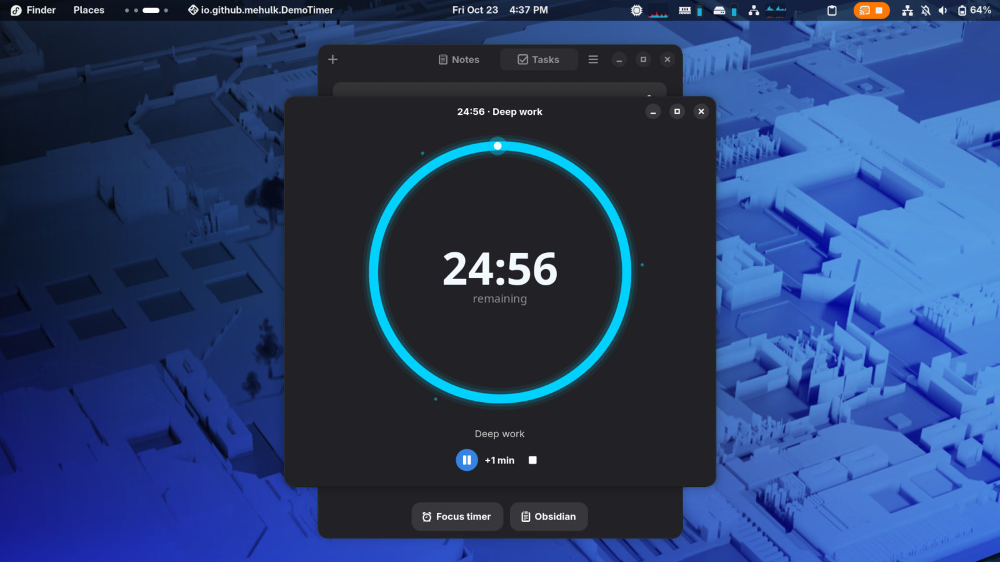<br><sub>Focus timer</sub> | 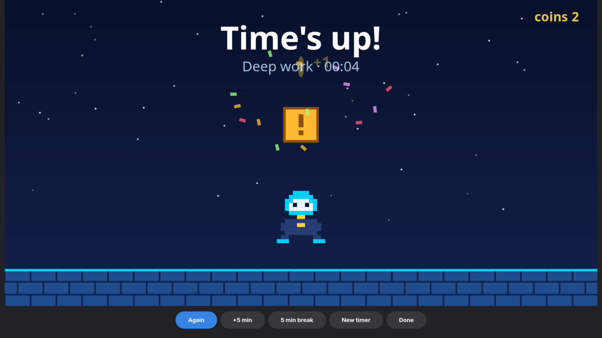<br><sub>…and the celebration when time is up</sub> |
| 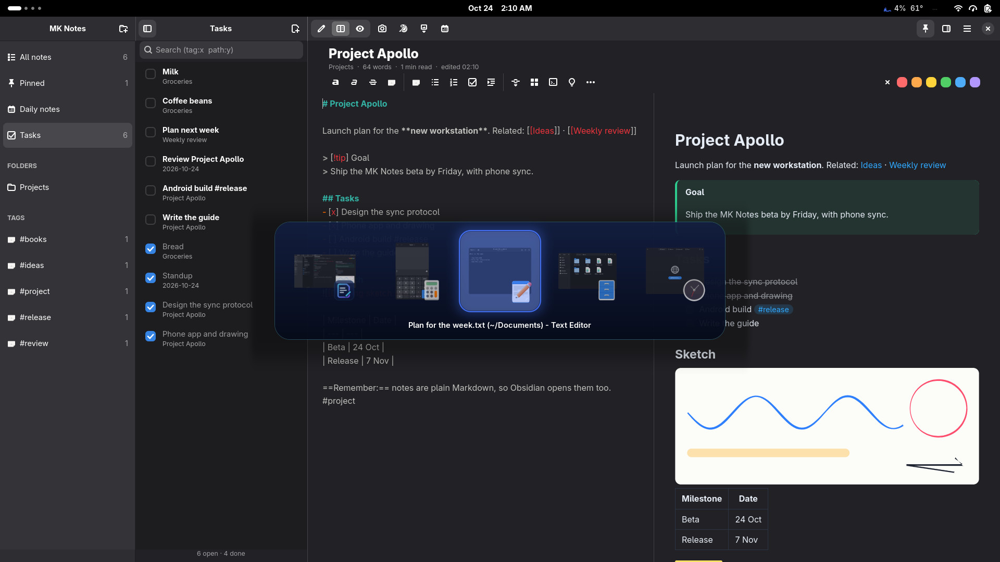<br><sub>Alt+Tab or three fingers · every window, live, in a compact card</sub> | 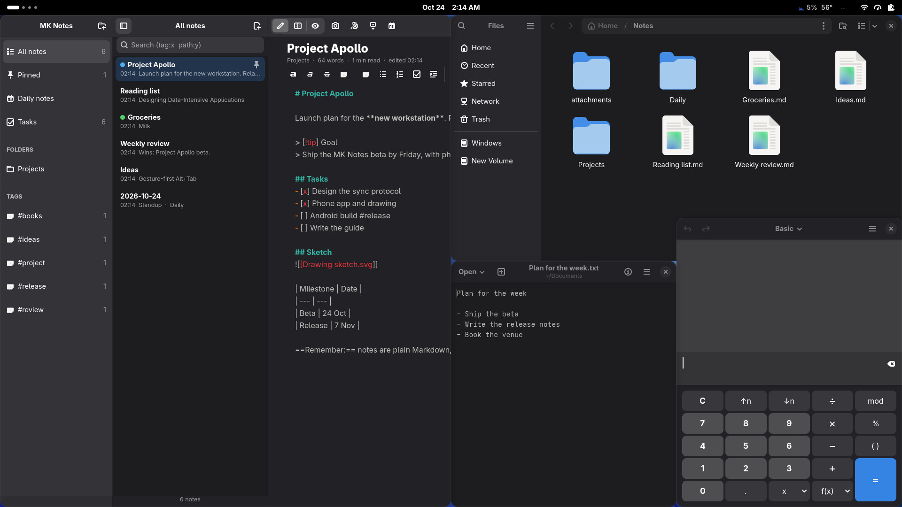<br><sub>Halves and quarters, Windows-style</sub> |

| 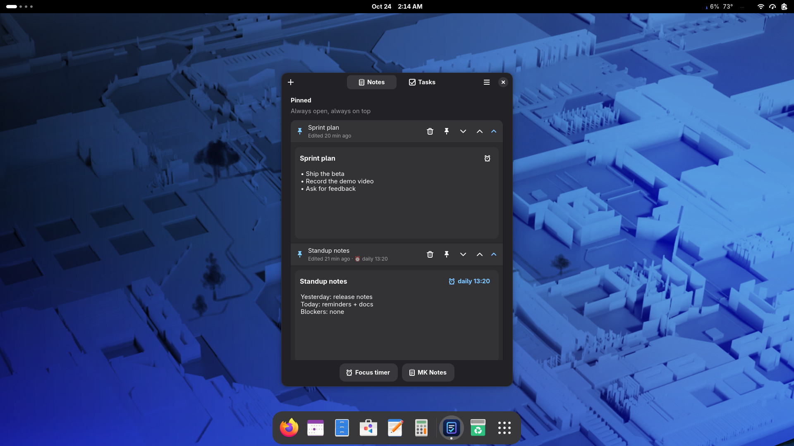<br><sub>Super+Shift+N · Companion: quick notes, tasks, reminders</sub> | 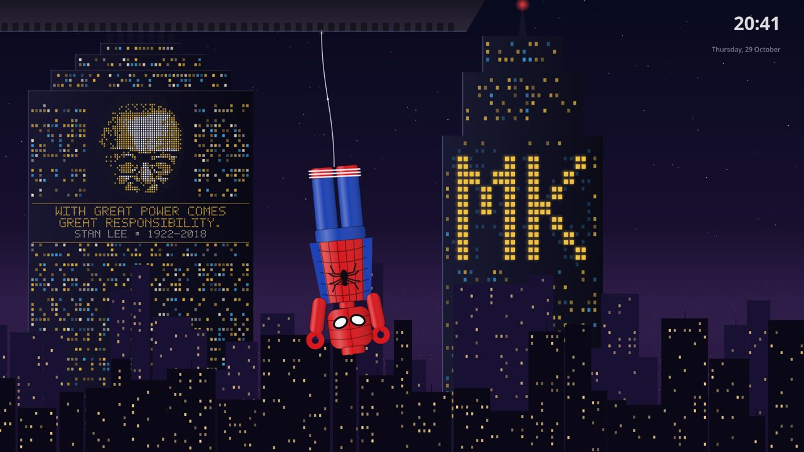<br><sub>Step away: Web Hang, one of the screensaver scenes</sub> |
| 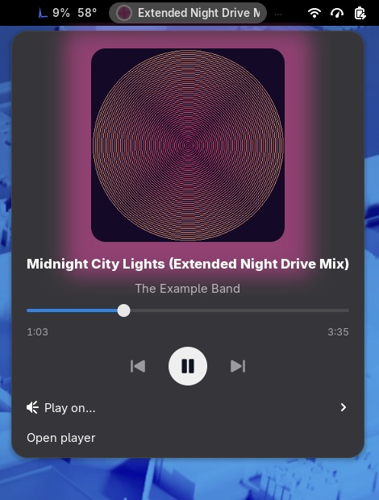<br><sub>Your music in the top bar: Spotify or any player</sub> | 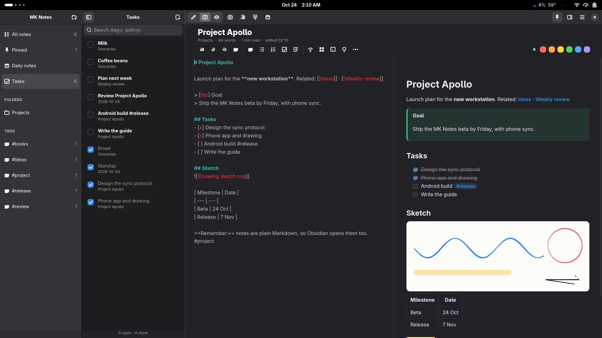<br><sub>Every checkbox from every note, in one list</sub> |

<p align="center">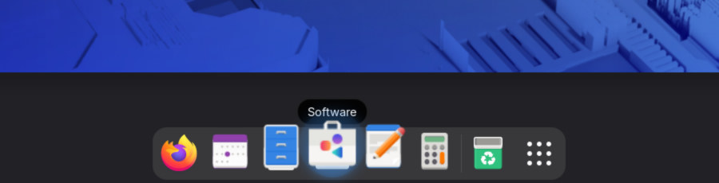<br><sub>Dock magnification and app-coloured glow</sub></p>

---

## What makes it different

Most Fedora post-install scripts ([fedorable](https://github.com/chetripley/fedorable), [Linutil](https://github.com/ChrisTitusTech/linutil) and others) install a list of packages once. MK Workstation also **remembers how your desktop is set up** and puts it back, safely, as often as you like.

| | Typical post-install script | MK Workstation |
| :--- | :--- | :--- |
| Run it twice | Often duplicates config lines or fails | Same result every time, nothing duplicated |
| Your own shortcuts and extensions | Frequently overwritten | Kept; MK settings are added alongside |
| GNOME extensions | Installed, settings lost | Installed **with your saved settings**, matched to your GNOME version |
| System files (`dnf.conf`, PAM) | Edited in place | Backed up once to `.bak` before the first change |
| Codecs and video | `ffmpeg` swap at best | Full codecs **plus** GPU video decoding for AMD, Intel or NVIDIA |
| Face unlock | Not offered, or one quick scan | Guided wizard: up to 5 face models across lighting conditions, several people, IR-aware security |
| After setup | You're on your own | `mk update` installs anything newly added and updates the system; `mk save` captures apps and settings you added; `mk doctor` health check; daily update notifications |
| Split screen | GNOME's left/right halves only | Windows-style snapping with quarters, Snap Assist, and MK's five snap layouts on Super+Z (1-5 tiles your windows) |
| Keyboard shortcuts | Added on top of whatever is there, clashes and all | One conflict-free keymap with Windows and macOS habits built in; `mk doctor` flags any key bound twice |
| Changed your mind | Reinstall | `mk restore` puts back the settings snapshot taken before every sync |
| Failures | Hidden or fatal | Listed at the end with what to do; full log in `/var/log` |

---

## Features

**Performance and system**
- DNF tuned: 10 parallel downloads, fastest mirror, `defaultyes`
- RPM Fusion (free and nonfree), Flathub, and Microsoft's VS Code repo
- Fewer false "not responding" popups while games or builds are busy
- Firmware update check through `fwupd`; it reports updates and never flashes anything on its own

**Multimedia**
- Full `ffmpeg` and GStreamer codecs (H.264, HEVC, AAC…)
- Hardware video decoding: detects your GPU and installs the right VA-API driver, so video plays on the GPU instead of the CPU

**Desktop, kept in sync**
- 16 curated GNOME extensions, installed from extensions.gnome.org for your exact GNOME version, **restored with their saved settings**
- `mk export` saves your current extensions and their settings into the repo; `mk sync` puts them back on any machine
- Alt+Tab across all workspaces, window snapping, screenshot and power keys, blur and dock styling

**Feels familiar from Windows and macOS, still GNOME**
- Windows habits: Super+E Files, Super+I Settings, Super+D desktop, Super+R run, Super+S search, Ctrl+Shift+Esc System Monitor, Super+V clipboard, Super+1–9 dock apps, Super+Alt+1–4 workspaces, Super+Ctrl+←/→ desktops, Super+Ctrl+D new desktop, taskbar-style dock (click focuses or minimizes, window thumbnails for apps with several windows)
- Windows-style multitasking: snap halves and quarters, Snap Assist, Super+Z snap layouts (50/50, 3-column studio, center stage, 2x2 grid, 70/30: press 1-5 and your windows tile, with a preview first), Super+Shift+Z puts your editor, terminal and localhost browser on a desktop of their own, always on top
- macOS habits: trackpad gestures (4 fingers ←/→ switch Spaces, 3 fingers ←/→ switch apps, 3 fingers ↑ Mission Control), an intellihide dock with macOS-style magnification whose icons glow softly in each app's own colour (Spotify green, VS Code blue) and that steps aside in the overview, animations 25% faster, genie minimize into the dock, a soft glide when windows open and close, Super+Ctrl+F full screen, Super+Shift+3 / 4 screenshots, Quick Look (press Space on a file), Finder-style Files (expandable folders, item counts), centred new windows, Super+Q / Super+H
- Linux habits kept: Ctrl+Alt+T terminal, workspaces on Super+Alt, the Super key opens the overview
- System tray icons (AppIndicator) and a keep-awake toggle (Caffeine)

**Lively, not loud**
- **Welcome after login:** a neon line races around the screen edges and "Welcome back home, sir." fades in once every extension has loaded; sir, ma'am, your name or your own words; optional calm British voice (Quick Settings › Welcome light, `mk welcome`)
- **Focus timer on the desktop:** a countdown ring in the top bar, a screensaver-style focus screen when you step away, fireworks when you're done
- Wobbly windows while dragging, Alt+Tab that pops in, Alt+` for windows of one app
- Dock magnification and a soft glow in each app's colour; calendar and Files with matching cyan hover and selection
- Workspace dots step aside for the volume pop-up instead of overlapping it
- MK's own apps have their own icons; put in yours with `mk icon companion ~/me.png`

**Made for your hardware** ([details](docs/HARDWARE.md))
- Detects the machine and tunes for it: fingerprint reader, IR or regular webcam, Intel/AMD/NVIDIA video, 2-in-1 sensors, battery
- **Fingerprint login** for login and sudo when a reader exists; `mk fingerprint` to enroll
- Smooth login: the login screen uses your display layout, so there's no flicker between login and desktop
- **Wallpaper accent:** Alt+Tab, calendar, hover glows, welcome line, timer ring and GNOME's accent take the most vivid colour of your wallpaper and follow it when it changes (`mk accent`)
- **Speaker tuning:** laptop speakers often sound thin on Linux because the maker's sound processing only ships for Windows; `mk sound on` adds warmth, bass the speakers can actually play, clearer voices and a limiter
- `mk device` shows what was found and what MK does about it

**Face unlock** ([details](docs/FACE-UNLOCK.md))
- A guided wizard records face models in normal, dim and bright light, so unlock keeps working as the room changes
- Several people can enroll on one computer
- IR cameras are picked automatically. On a regular webcam it keeps strict matching and asks before enabling face unlock for `sudo`

**Tools and upkeep**
- `mk doctor`: one-screen health check covering updates, codecs, GPU decoding, broken extensions, shortcut conflicts, failed services, disk space and face unlock
- A settings snapshot before every sync, undone with `mk restore`
- Daily background check that tells you when a new version of this repo is available
- **Shortcuts window (Super+/):** every shortcut and gesture, live, each marked working, clashing, unset or broken; click to change keys, + to add your own commands, Reset to go back
- **MK Notes (Super+N):** notes on A4 pages that grow as you write (Page X of Y), real tables (resize columns, add rows with Tab, move them), rich text, comments in the margin, sticky notes with colours and layer order, pictures with Word-style rotation and resizing, shapes and graphs, drawing, PDFs attached or laid out as printouts, notebooks, links and a mind map, PDF and Word export, locks with auto-lock, and encrypted phone sync. Saved as Markdown files. See [docs/NOTES.md](docs/NOTES.md)
- **A private lock screen:** no notifications (GNOME's lock-screen notifications stay off; switch them on in Settings and they show as compact pills) and no screenshots while locked. With WACK Sonoma Live Lockscreen switched on: the Sonoma clock, a live video behind it (silent unless you turn its sound on), battery and weather in one pill under the time, a media hub (cover, Spotify / YouTube badge, Previous / Play / Next and a seek bar) that fades in when music plays (Sonoma Lock Screen › Now Playing switches it off), and a power button with Hibernate
- **MK Control Center and tour:** quick actions, every `mk` command as a card, MK Lock, face and fingerprint enrollment in windows, the security check; a six-slide tour (from the Control Center)
- **Companion (Super+Shift+N):** notes you can pin, reorder and fold away; a task list you tick off and pin; one click to MK Notes or the focus timer
- **Reminders:** on any note or task, in 10 min, at 18:00, or every day; they fire even with the Companion closed, with Open and Snooze
- **Capture from the terminal:** `mk note "idea"`, `mk task "pay rent" 18:00`, `mk remind "stretch" 45m`, `mk list`
- **Focus mode:** the timer can silence notifications while it counts and puts them back afterwards
- **Smart power (laptops):** performance when plugged in, balanced on battery, power-saver below 25%, switching by itself; `mk power off` if you'd rather choose
- **Morning brief:** one notification a day with your open tasks and today's reminders
- **Housekeeping:** Trash and temp files older than 30 days are cleared automatically; slow search providers are skipped so overview search stays instant
- **Focus timer:** type a time and press Enter, hides while it counts, a full-screen pixel celebration with a chime (or a sound you pick, or silence)
- **Screensaver:** step away and a scene plays: a brick-built hero hanging beside a skyscraper, a brick-built caped knight in the rain, or a cyan-and-amber hex terminal decoding the time; pick one from live previews or shuffle in the Screensaver app (`mk screensaver`)
- **Window switcher:** Alt+Tab and three-finger swipes open a compact card of live windows at once; 1–9 sends a window to that desktop
- **Top bar:** a system monitor (CPU, GPU, memory, disk activity, temperatures in °C) with an internet speed test (also `mk speedtest`), and a media tile for Spotify or any player (album art, seek, choose speakers)
- **Locks:** `mk lock app Settings` makes an app ask for your fingerprint first; `mk lock ~/Private` encrypts a folder that opens only after the same check and closes when the screen locks; manage them in the MK Control Center (`mk center`) or right-click a folder in Files
- **MK Command Centre** (`mk-control-center`, `mk center`): quick actions, every `mk` command as a card, MK Lock and the security check in one window, plus two studios: **Wallpaper & Sonoma Lockscreen** (a live 16:9 preview, desktop and lock screen media, sound and volume, clock layout, style and colour, scrim, glass card, greeting) and **Top Bar, Logo & Dock** (a round custom logo 14-30 px, the app indicator's fade, the dock's translucency)
- **App Nap:** when memory runs short, apps you left minimized for a while are paused and wake the moment you switch back
- **Accounts:** `mk users add NAME` for a second person (their own settings and face), `mk guest on` for a Guest login that starts empty every time
- **Tour:** `mk tour` (or the Control Center) walks through the desktop, with a button to try each thing
- **A different greeting each time:** morning, Friday, your birthday, long time no see, or your own lines
- **Make it yours:** rename it (`mk rename`), change any shortcut, app, extension or colour without touching code; see [docs/CUSTOMIZING.md](docs/CUSTOMIZING.md). Hackers: [docs/ARCHITECTURE.md](docs/ARCHITECTURE.md) and [docs/REFERENCE.md](docs/REFERENCE.md)
- OCR text-from-screen and webcam controls
- `just` recipes and GitHub Actions ShellCheck on every push

---

## Quick start

On Fedora Workstation, open **Terminal** and run:

```bash
sudo dnf install -y git
git clone https://github.com/MehulK-techie/fedora-workstation-config.git ~/fedora-workstation-config
cd ~/fedora-workstation-config
sudo ./setup.sh
```

Log out and back in, then optionally set up face unlock:

```bash
mk face
```

Skip face unlock entirely with `sudo ./setup.sh --no-face`. New to Linux? Follow the [step-by-step guide](docs/GUIDE.md).

---

## What gets installed

Edit [`apps/flatpaks.txt`](apps/flatpaks.txt) and [`apps/dnf-packages.txt`](apps/dnf-packages.txt) to choose your own. Both are grouped by purpose, so you can delete whole sections.

| Group | Apps |
| :--- | :--- |
| Browsing, notes, office | Zen Browser, MK Notes (built in), Joplin, ONLYOFFICE |
| Desktop tools | Extension Manager, GNOME Tweaks, Sushi (Quick Look), Frog (text from images), FlipClock, Flameshot |
| Communication and audio | ZapZap (WhatsApp), Spotify, SonoBus, EasyEffects |
| Gaming | Lutris, GameMode, Gamescope, MangoHud, vkBasalt |
| Development | VS Code, Distrobox, Android tools, GCC, Make, Node.js, pip |
| Terminal | btop, fastfetch, fzf, ripgrep, zoxide, ncdu, just, chezmoi, 7-Zip, unrar |
| Media and codecs | full ffmpeg, GStreamer plugins, VA-API driver for your GPU, Loupe (images), GNOME's Camera (the only camera app: Kamoso, Cheese, Guvcview, DroidCam and Camera Controls are removed), Media Writer |

**Extensions** ([guide](docs/EXTENSIONS.md)): seven, and only these: MK's own three (**MK Shell Engine**: dock, top bar, window and workspace animations, snap layouts, Dynamic Island, Deep Focus; **mk-indicator**: system monitor, welcome light, focus timer, clipboard, wallpaper accent; and **MehulK Workstation & Sonoma Suite**), plus Blur my Shell, Caffeine (keep awake), Text Extractor and Touchpad Gesture Customization. A fresh install turns exactly these on and every other extension off. The Suite (formerly WACK Sonoma Live Lockscreen) brings the lock screen above, the desktop's live wallpaper with optional sound, Finder (Fedora logo), an icon-only Places menu and the app indicator in the top bar, and Hibernate in the Finder menu, Quick Settings and on the lock screen (real hibernation needs a one-time `sudo scripts/setup-hibernate.sh` and doesn't work while Secure Boot is on; until then the Hibernate buttons sleep instead, keeping everything open in memory, and say so).

---

## Everyday commands

| `mk` command | `just` recipe | What it does |
| :--- | :--- | :--- |
| `mk doctor` | | Health check with a fix for every problem it finds |
| `mk sync` | `just sync` | Re-apply desktop settings and saved extension settings |
| `mk export` | `just export` | Save your current settings and extensions into the repo |
| `mk restore` | | Undo the last sync from its settings snapshot |
| `mk update` | `just update` | **Update everything:** pull the repo, install anything newly added to the app lists, re-apply settings and extensions, then system and Flatpak updates (`--check` to preview) |
| `mk save` | `just save` | Add apps you installed yourself to the lists, save extensions and settings, and commit |
| `mk face` | `just face` | Face unlock wizard (`--models N`, `--user NAME`, `--tune-only`) |
| `mk shortcuts` | | Shortcuts window: see, change, add or reset shortcuts (also Super+/) |
| `mk note` · `mk task` · `mk remind` · `mk list` | | Add notes and tasks (with reminders) from a terminal; list them |
| `mk focus 25 "Label"` | | Start the focus timer in the background |
| `mk power` | | Smart power profiles: status, on, off |
| `mk device` | | What this computer has and what MK tunes for it |
| `mk fingerprint` | | Enroll a finger for login and sudo (`list`, `delete`) |
| `mk welcome` | | Welcome light and greeting: on, off, test, edit, title, voice |
| `mk screensaver show web` · `scene` · `delay` · `off` | | Screensaver scenes when you step away |
| `mk welcome variety` · `birthday 07-14` · `lines` | | A different greeting each time; your own lines |
| `mk notes` · `mk notes today` · `mk notes serve` | | MK Notes; today's note; phone sync without the window |
| `mk sound on\|off` | | Laptop speaker tuning (EasyEffects profile) |
| `mk icon APP IMAGE` | | Use your own image as an MK app icon |
| `mk accent auto` | | Accent colour from your wallpaper (or `mk accent #hex`), kept calm for a dark desktop |
| `mk wallpaper` | `Super+W` | Next wallpaper from Pictures/Wallpapers and MK's own three, traced in contour lines then flooded in; `set FILE`, `list` |
| `mk rename "Name" TAG` | | Rename MK's windows, notifications and top-bar tag |
| `mk uninstall` | | Remove MK's tools, shortcuts and helpers from your account |
| | `just setup` | Full system setup (`sudo ./setup.sh`) |
| | `just check` | Lint every script (same as CI) |

## Keyboard shortcuts

Press **Super+/** for the Shortcuts window: it always matches your keyboard, shows which shortcuts work, and lets you change them. Every default lives in [config/shortcuts.conf](config/shortcuts.conf).

| | Shortcut | Action |
| :--- | :--- | :--- |
| **Windows** | `Alt+Tab` · `Super+Tab` | Every window from every workspace as a live thumbnail, themed to match · switch apps |
| | `Super+←/→` | Snap to the left / right half |
| | `Super+←` then `Super+↑/↓` | Snap to a quarter |
| | `Super+Z`, then `1`-`5` | Snap layouts: the focused window takes the main part; your other windows fill the rest when they fit, otherwise Snap Assist asks which goes where (1-9 or click) |
| | `Super+Left` / `Super+Right` | Snap to a half (again: back); with two windows side by side, swap them |
| | `Super+Alt+A` | The calendar, ready to type a reminder ("Review code in 25m", "Standup @ 11:30") |
| | `Super+Shift+Z` | Coder desktop: editor, terminal and localhost browser on a fresh desktop, side by side |
| | `Super+↑` · `Super+↓` | Maximize · restore |
| | `Super+Ctrl+T` · `Super+Ctrl+C` · `Super+Ctrl+F` | Always on top · centre window · full screen |
| | `Super+Ctrl+←/→` · `Super+Ctrl+D` | Previous / next desktop · new desktop (add `Shift` to take the window along) |
| | `Super+D` · `Super+E` · `Super+I` | Show desktop · Files · Settings |
| | `Super+S` · `Super+R` | Search · run a command |
| | `Super+1…9` | Open the 1st…9th dock app |
| | `Ctrl+Shift+Esc` | System Monitor |
| | `Super+V` · `Super+.` | Clipboard history · emoji |
| **Screenshots** | `Print` (`Fn+PrtSc`) · `Super+Shift+3` | Whole screen, instantly (saved and copied, no overlay) |
| | `Super+Shift+S` · `Super+Shift+4` · `Shift+Print` | **Select an area**: taken the moment you let go |
| | `Alt+Print` | Current window |
| | `Super+Shift+C` · `Super+Alt+T` | Copy text from the screen (OCR) |
| | `Super+Return` | Scratchpad (the Companion) |
| | `Super+F10` | Exam mode: no notifications, media paused, quiet power (`mk exam`) |
| **macOS** | `Super+Q` · `Super+H` | Close · hide (minimize) |
| | `Space` in Files | Quick Look preview |
| **Linux / GNOME** | `Super` · `Super+A` | Overview · all apps |
| | `Ctrl+Alt+T` | Terminal |
| | `Super+Alt+←/→` · `Super+Alt+1…4` | Previous/next workspace · go to workspace |
| | `Super+Shift+A` · `Super+M` | Quick settings · notifications |
| | `Super+L` · `Super+Backspace` | Lock · shut down / restart |
| | `Ctrl+Alt+End` · `Ctrl+Alt+Home` · `Ctrl+Alt+PgDn` | Shut down · restart (both ask first) · sleep |
| **Apps** | `Super+N` · `Super+Alt+N` · `Super+Ctrl+N` · `Super+B` | MK Notes · today's note · quick note · web browser |
| **MK tools** | `Super+/` · `Super+Shift+N` · `Super+C` | Shortcuts window · Companion (notes, tasks, timer) · Photo Booth |
| **Touchpad** | 4 fingers ←/→ · 3 fingers ←/→ | Switch workspaces (Spaces) · switch windows, on every workspace |
| | 3 fingers ↑/↓ · 4 fingers ↑/↓ | Overview (Mission Control) · maximize / restore the window |
| | 3-finger pinch · 4-finger pinch | Volume · show desktop (pinch again to bring windows back) |

Every screenshot is saved to `~/Pictures/Screenshots` and copied to the clipboard. From a terminal or a script: `mk-screenshot --instant` or `--area` (through the desktop's screenshot portal, which asks once whether to allow it). `Ctrl+Alt+←/→` is left free for Zen Browser.

---

## Beginner's guide and troubleshooting

**Changing how things look.** Open **MK Command Centre** (Finder menu › MK Command Centre…, or `mk-control-center`). The live preview on the left follows every change you make on the right.
- *Live wallpaper:* Studio › Media › Desktop / Lock Screen › Choose…: any video, GIF or picture. Sound is off unless you turn it on, and it only plays while you're on the bare desktop.
- *Lock screen:* the layout buttons under the preview, then Clock Styler for font, colour, glow, date format and a tagline.
- *Logo and dock:* the Top Bar tab: your own picture as a round logo (14-30 px), the dock theme, glass opacity, corners, running-dot style and **Glow Colour**.

**Using Notes.** Select text for the floating toolbar (fonts, bold, colours, lists, alignment). Paste or insert a picture; it moves with the line it sits on (click it, then the wrap button, to pin it to the page instead). Ctrl+Z undoes text, pictures and deleted tables alike. Insert Table drops a 3 x 3 table; Esc in a cell selects the table, Delete removes it. Export › PDF lays everything out top to bottom in the order it sits on the page (text never runs under a picture), without a title or date header.

**Using Photo Booth.** Pick a look in the strip (or press G to see all of them live), press Space or the red button. With the 4-Cut Strip it takes four, a second apart. F11 for fullscreen.

**Something's wrong?**
| Problem | Fix |
| :--- | :--- |
| A new feature doesn't show up after `./sync.sh` | Log out and back in: GNOME loads extension code at login. |
| No sound from apps | `./scripts/setup-audio.sh` (no sudo), then try again. |
| Hibernate just sleeps | Real hibernation needs `sudo scripts/setup-hibernate.sh`, and Secure Boot must be off; until then the button sleeps and says so. |
| Weather shows nothing | It needs the internet once (MK Command Centre › Studio › Clock Styler › Live Weather is on by default); after that the last reading shows even offline. |
| Anything else | `mk doctor` checks the whole system and tells you the fix. `mk restore` undoes the last sync. |

---

## Repository structure

```text
.
├── setup.sh              System setup (sudo); finishes by running sync.sh as you
├── sync.sh               Every desktop setting, extension and shortcut (no sudo)
├── register-face.sh      Face unlock wizard (sudo)
├── sync-shortcuts.sh     Compatibility shim for older installs; runs sync.sh
├── justfile              just setup | sync | face | export | update | check
├── apps/                 dnf-packages.txt, flatpaks.txt
├── bin/                  mk, mk-apps, mk-doctor, ocr-snip, show-shortcuts, mk-companion, mk-timer, mk-reminders,
│                         mk-power, mk-voice, mk-sound, camera-controls
├── assets/               App icons and launchers, speaker profile
├── lib/mkworkstation/    Shared Python: branding, shortcut catalogue, notes/tasks/reminders
├── config/
│   ├── shortcuts.conf           Every keyboard shortcut (group | label | target | keys)
│   ├── brand.conf               The name shown in MK's windows and top bar
│   ├── dock.conf · power.conf   Dock magnification; smart power thresholds
│   ├── enabled-extensions.txt   The four third-party extensions a fresh install adds
│   ├── extension-settings/      One saved .dconf per extension
│   └── *.dconf                  Reference snapshots written by mk export
├── extensions/           MK's own three: mk-shell-engine, mk-indicator, wack-sonoma-lockscreen (the Suite)
├── scripts/              update-repo.sh (mk export), lint.sh
├── docs/                 GUIDE, HARDWARE, CUSTOMIZING, ARCHITECTURE, REFERENCE, FACE-UNLOCK, EXTENSIONS, BUGS
│   ├── MK-Workstation-Overview.pdf   14-slide overview; overview/ rebuilds it
│   └── assets/screens/           Screenshots (Fedora wallpaper)
└── .github/              ShellCheck CI, issue and pull request templates
```

## Documentation

| Document | For |
| :--- | :--- |
| [docs/GUIDE.md](docs/GUIDE.md) | Installing and using it: beginners, everyday users, and contributors. Includes undo and troubleshooting. |
| [docs/CUSTOMIZING.md](docs/CUSTOMIZING.md) | Making it yours or forking it: rename, shortcuts, apps, extensions, colours, without touching the scripts |
| [docs/RELEASING.md](docs/RELEASING.md) | For the maintainer: cutting a release and where to share it |
| [docs/KEYBINDINGS.md](docs/KEYBINDINGS.md) | Every shortcut, gesture, switcher key and MK Notes key in one place |
| [docs/NOTES.md](docs/NOTES.md) | MK Notes: writing, drawing, screenshots, PDF, publishing, history, and the phone app with Wi-Fi sync |
| [docs/FEATURES.md](docs/FEATURES.md) | Every feature, app, command and shortcut, split into what MK built and what it configures or installs from others |
| [docs/WINDOWS.md](docs/WINDOWS.md) | Not built yet: what a Windows port of MK Notes, the Companion, Focus Timer and Speed Test takes, and the plan for it |
| [docs/MK-Workstation-Overview.pdf](docs/MK-Workstation-Overview.pdf) | The 16-page overview to show someone: clickable contents and links, screenshots (rebuild: `just overview`) |
| [docs/MK-Workstation-Overview.pptx](docs/MK-Workstation-Overview.pptx) | The same story as a 14-slide PowerPoint deck with speaker notes, for presenting (rebuild: `just deck`) |
| [docs/HARDWARE.md](docs/HARDWARE.md) | What gets detected and tuned: fingerprint, cameras, GPUs, 2-in-1s, power, login screen; tested machines |
| [docs/ARCHITECTURE.md](docs/ARCHITECTURE.md) | How the pieces fit: setup, sync, the shared library, the apps, the shell extension, and how to add things |
| [docs/REFERENCE.md](docs/REFERENCE.md) | Every `mk` command, tool, file, format, timer and path |
| [docs/FACE-UNLOCK.md](docs/FACE-UNLOCK.md) | Face unlock in three steps, multiple faces, lighting, and security |
| [docs/EXTENSIONS.md](docs/EXTENSIONS.md) | What each extension does and how to adjust it, with clicks or with commands |
| [docs/BUGS.md](docs/BUGS.md) | Full audit: bugs, duplicated code, false claims, and how this compares to similar projects |
| [CONTRIBUTING.md](CONTRIBUTING.md) · [CODE_OF_CONDUCT.md](CODE_OF_CONDUCT.md) | Rules and checks for changes; community standards |
| [SECURITY.md](SECURITY.md) | How to report security problems; every security-relevant change MK makes |
| [THIRD_PARTY.md](THIRD_PARTY.md) | Bundled third-party code, its license and our patch |
| [CHANGELOG.md](CHANGELOG.md) | What changed between versions |

---

## FAQ

**Does it work on other distributions, Silverblue or KDE?** No. `setup.sh` checks for Fedora Workstation with GNOME and stops before changing anything on anything else.

**Will it delete my settings?** No. Lists such as enabled extensions and custom shortcuts are added to, not replaced. System files get a `.bak` copy before their first change, every sync saves a snapshot (`mk restore`), and your pre-MK desktop is kept for good. `mk uninstall` removes MK from your account. See [Undo and uninstall](docs/GUIDE.md#undo-and-uninstall).

**Is face unlock safe?** On Fedora 45 (MK's OpenCV engine, `scripts/setup-face-auth.sh`) a regular webcam has no depth or infrared check, so a good photo may pass: it's a convenience, your password always works, and the setup asks before adding face to `sudo` or the lock screen. With Howdy and an IR camera (the Windows Hello kind), it's much harder to fool than a webcam, though Howdy itself warns it is less secure than a password. With a regular webcam a printed photo may pass, so the wizard keeps matching strict and only adds face unlock to `sudo` if you say yes. Your password always works.

**How do I keep my own tweaks?** Change anything in GNOME or Extension Manager, then run `mk export` and commit. `mk sync` restores it on any machine.

**My laptop has an NVIDIA GPU.** Setup installs NVIDIA's video-decoding library and tells you how to add the proprietary driver yourself, because with Secure Boot it needs a signing key that only you can approve.

---

## Roadmap

- Interactive section picker (`gum`/`dialog`), inspired by fedorable and Linutil
- Btrfs snapshot before system changes, once a safe Snapper default is in place
- A proper package (RPM/COPR) once the layout is stable
- Container-based CI that runs `sync.sh` against a headless GNOME session

## Contributing

Fork, change, run `just check`, open a pull request. See [CONTRIBUTING.md](CONTRIBUTING.md).

## Credits

Ideas adopted from [fedorable](https://github.com/chetripley/fedorable), [PYFO](https://github.com/d4rklynk/PYFO), [Linutil](https://github.com/ChrisTitusTech/linutil), [Universal Blue Bluefin](https://projectbluefin.io/) and the [RPM Fusion](https://rpmfusion.org/) howtos. Face unlock is powered by [Howdy](https://github.com/boltgolt/howdy) up to Fedora 44, and on Fedora 45 by MK's own engine on OpenCV's YuNet and SFace models ([OpenCV Zoo](https://github.com/opencv/opencv_zoo)). Extensions belong to their authors on [extensions.gnome.org](https://extensions.gnome.org/). The Stan Lee photo in the Web Hang screensaver is by Gage Skidmore, [CC BY-SA 3.0](assets/screensaver/CREDITS.md).

## License

[MIT](LICENSE)
