<div align="center">

# MK Workstation

**One command turns a fresh Fedora Workstation into a fast, keyboard-first, fully equipped GNOME desktop, and keeps it that way.**


-blue?logo=gnome)
[](https://github.com/MehulK-techie/fedora-workstation-config/actions/workflows/shellcheck.yml)


[Quick start](#quick-start) · [Overview (PDF)](docs/MK-Workstation-Overview.pdf) · [All features](docs/FEATURES.md) · [Guide](docs/GUIDE.md) · [Hardware](docs/HARDWARE.md) · [Customize](docs/CUSTOMIZING.md) · [Reference](docs/REFERENCE.md)

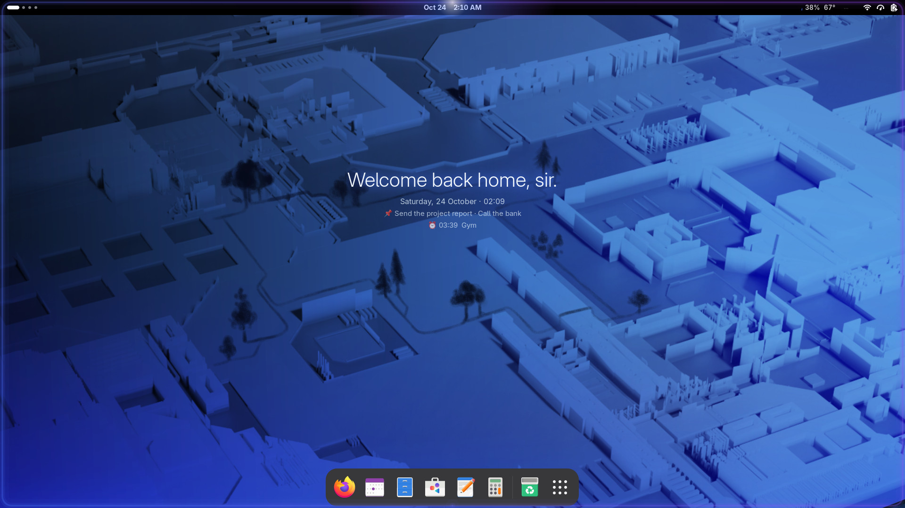

<sub>The overview on an HP ENVY x360 13 running MK Workstation. Wallpaper: Fedora 44 default (CC BY-SA 4.0).</sub>

**New here? [The 14-slide overview (PDF)](docs/MK-Workstation-Overview.pdf) explains stock Fedora and what this adds.**

</div>

---

## A look around

| | |
| :---: | :---: |
| 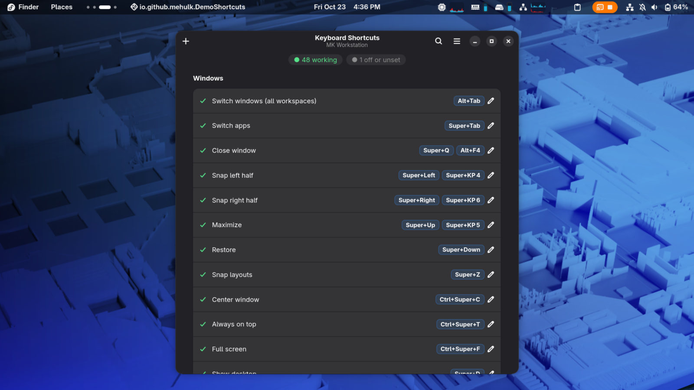<br><sub>Super+/ · every shortcut, live, editable</sub> | 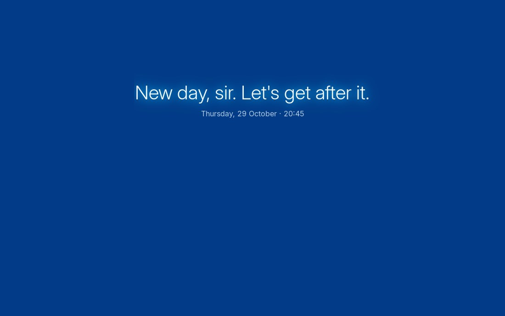<br><sub>Super+N · MK Notes, edit with live preview</sub> |
| 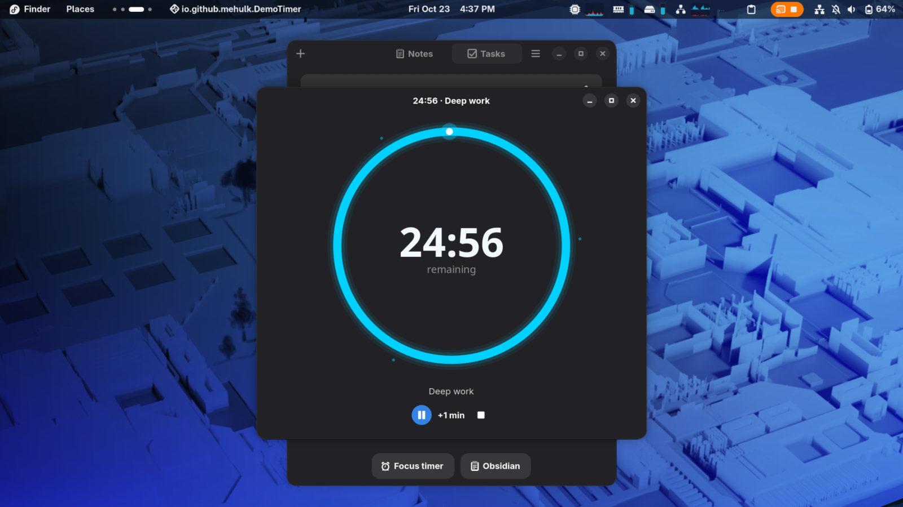<br><sub>Focus timer</sub> | 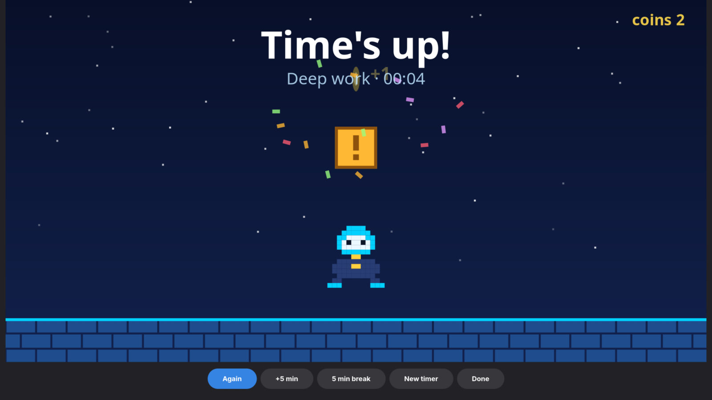<br><sub>…and the celebration when time is up</sub> |
| 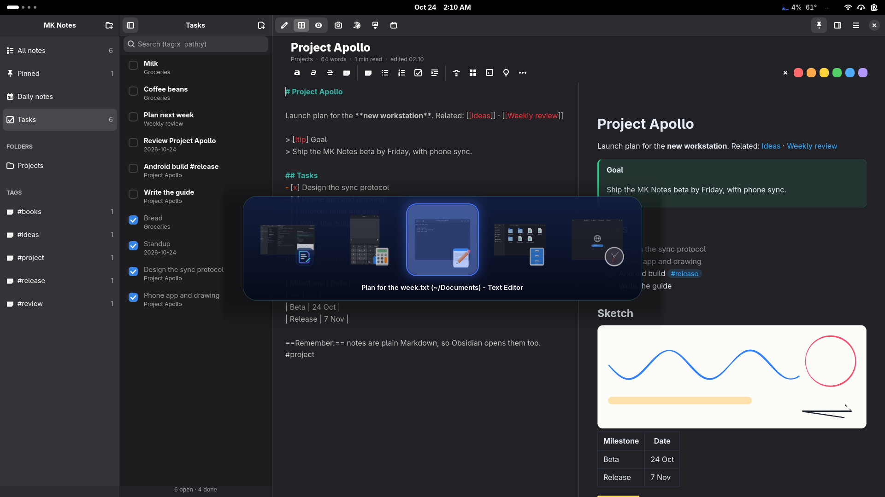<br><sub>Alt+Tab or three fingers · every window, live, in a compact card</sub> | 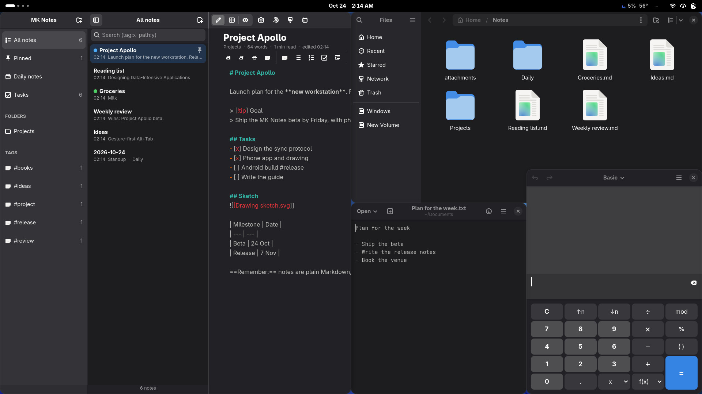<br><sub>Halves and quarters, Windows-style</sub> |

| 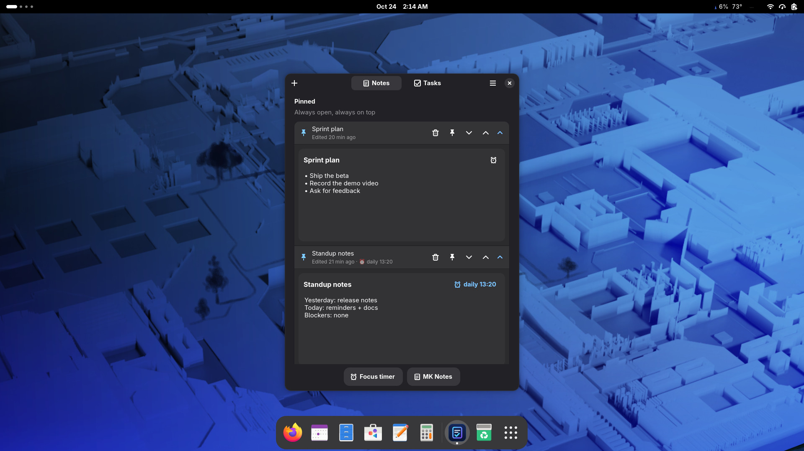<br><sub>Super+Shift+N · Companion: quick notes, tasks, reminders</sub> | 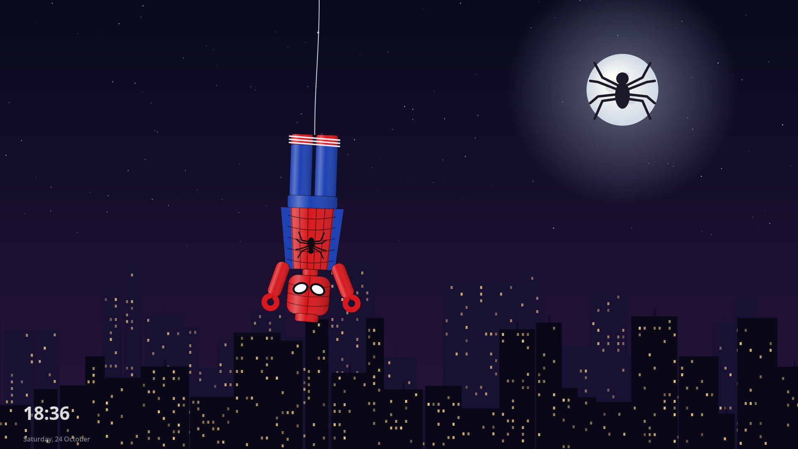<br><sub>Step away: Web Hang, one of the screensaver scenes</sub> |
| 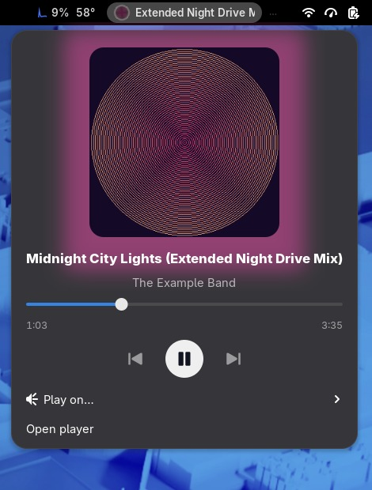<br><sub>Your music in the top bar: Spotify or any player</sub> | 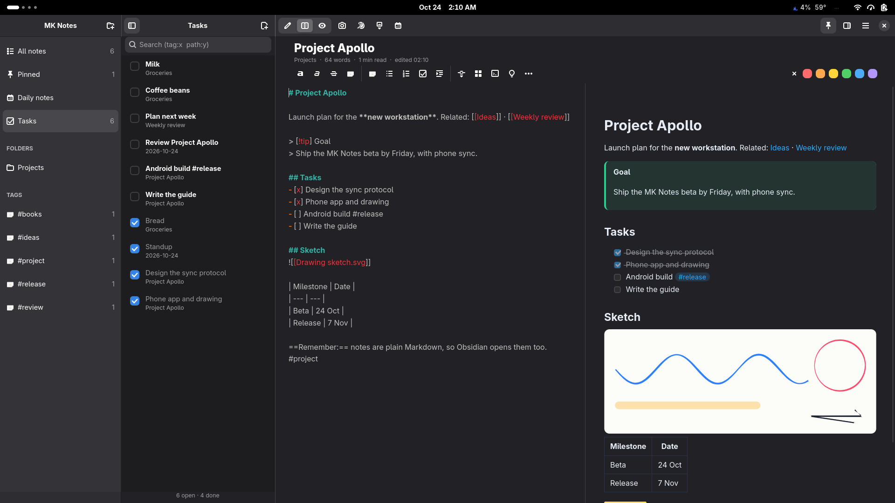<br><sub>Every checkbox from every note, in one list</sub> |

<p align="center">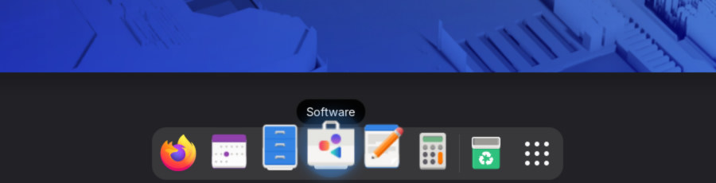<br><sub>Dock magnification and app-coloured glow</sub></p>

---

## What makes it different

Most Fedora post-install scripts ([fedorable](https://github.com/chetripley/fedorable), [Linutil](https://github.com/ChrisTitusTech/linutil) and others) install a list of packages once. MK Workstation also **remembers how your desktop is set up** and puts it back, safely, as often as you like.

| | Typical post-install script | MK Workstation |
| :--- | :--- | :--- |
| Run it twice | Often duplicates config lines or fails | Same result every time, nothing duplicated |
| Your own shortcuts and extensions | Frequently overwritten | Kept; MK settings are added alongside |
| GNOME extensions | Installed, settings lost | Installed **with your saved settings**, matched to your GNOME version |
| System files (`dnf.conf`, PAM) | Edited in place | Backed up once to `.bak` before the first change |
| Codecs and video | `ffmpeg` swap at best | Full codecs **plus** GPU video decoding for AMD, Intel or NVIDIA |
| Face unlock | Not offered, or one quick scan | Guided wizard: up to 5 face models across lighting conditions, several people, IR-aware security |
| After setup | You're on your own | `mk update` installs anything newly added and updates the system; `mk save` captures apps and settings you added; `mk doctor` health check; daily update notifications |
| Split screen | GNOME's left/right halves only | Windows-style snapping with quarters, Snap Assist and six snap layouts on Super+Z |
| Keyboard shortcuts | Added on top of whatever is there, clashes and all | One conflict-free keymap with Windows and macOS habits built in; `mk doctor` flags any key bound twice |
| Changed your mind | Reinstall | `mk restore` puts back the settings snapshot taken before every sync |
| Failures | Hidden or fatal | Listed at the end with what to do; full log in `/var/log` |

---

## Features

**Performance and system**
- DNF tuned: 10 parallel downloads, fastest mirror, `defaultyes`
- RPM Fusion (free and nonfree), Flathub, and Microsoft's VS Code repo
- Fewer false "not responding" popups while games or builds are busy
- Firmware update check through `fwupd`; it reports updates and never flashes anything on its own

**Multimedia**
- Full `ffmpeg` and GStreamer codecs (H.264, HEVC, AAC…)
- Hardware video decoding: detects your GPU and installs the right VA-API driver, so video plays on the GPU instead of the CPU

**Desktop, kept in sync**
- 16 curated GNOME extensions, installed from extensions.gnome.org for your exact GNOME version, **restored with their saved settings**
- `mk export` saves your current extensions and their settings into the repo; `mk sync` puts them back on any machine
- Alt+Tab across all workspaces, window snapping, screenshot and power keys, blur and dock styling

**Feels familiar from Windows and macOS, still GNOME**
- Windows habits: Super+E Files, Super+I Settings, Super+D desktop, Super+R run, Super+S search, Ctrl+Shift+Esc System Monitor, Super+V clipboard, Super+1–9 dock apps, Super+Ctrl+←/→ desktops, Super+Ctrl+D new desktop, taskbar-style dock (click focuses or minimizes, window thumbnails for apps with several windows)
- Windows-style multitasking: snap halves and quarters, Snap Assist, Super+Z snap layouts (halves, 66/34, three columns, left + two stacked, quarters, focus centre), always on top
- macOS habits: trackpad gestures (4 fingers ←/→ switch Spaces, 3 fingers ←/→ switch apps, 3 fingers ↑ Mission Control), an auto-hiding dock with macOS-style magnification whose icons glow softly in each app's own colour (Spotify green, VS Code blue) and that steps aside in the overview, animations 25% faster, genie minimize into the dock, a soft glide when windows open and close, Super+Ctrl+F full screen, Super+Shift+3 / 4 screenshots, Quick Look (press Space on a file), Finder-style Files (expandable folders, item counts), centred new windows, Super+Q / Super+H
- Linux habits kept: Ctrl+Alt+T terminal, workspaces on Super+Alt, the Super key opens the overview
- System tray icons (AppIndicator) and a keep-awake toggle (Caffeine)

**Lively, not loud**
- **Welcome after login:** a neon line races around the screen edges and "Welcome back home, sir." fades in once every extension has loaded; sir, ma'am, your name or your own words; optional calm British voice (Quick Settings › Welcome light, `mk welcome`)
- **Focus timer on the desktop:** a countdown ring in the top bar, a screensaver-style focus screen when you step away, fireworks when you're done
- Wobbly windows while dragging, Alt+Tab that pops in, Alt+` for windows of one app
- Dock magnification and a soft glow in each app's colour; calendar and Files with matching cyan hover and selection
- Workspace dots step aside for the volume pop-up instead of overlapping it
- MK's own apps have their own icons; put in yours with `mk icon companion ~/me.png`

**Made for your hardware** ([details](docs/HARDWARE.md))
- Detects the machine and tunes for it: fingerprint reader, IR or regular webcam, Intel/AMD/NVIDIA video, 2-in-1 sensors, battery
- **Fingerprint login** for login and sudo when a reader exists; `mk fingerprint` to enroll
- Smooth login: the login screen uses your display layout, so there's no flicker between login and desktop
- **Wallpaper accent:** Alt+Tab, calendar, hover glows, welcome line, timer ring and GNOME's accent take the most vivid colour of your wallpaper and follow it when it changes (`mk accent`)
- **Speaker tuning:** laptop speakers often sound thin on Linux because the maker's sound processing only ships for Windows; `mk sound on` adds warmth, bass the speakers can actually play, clearer voices and a limiter
- `mk device` shows what was found and what MK does about it

**Face unlock** ([details](docs/FACE-UNLOCK.md))
- A guided wizard records face models in normal, dim and bright light, so unlock keeps working as the room changes
- Several people can enroll on one computer
- IR cameras are picked automatically. On a regular webcam it keeps strict matching and asks before enabling face unlock for `sudo`

**Tools and upkeep**
- `mk doctor`: one-screen health check covering updates, codecs, GPU decoding, broken extensions, shortcut conflicts, failed services, disk space and face unlock
- A settings snapshot before every sync, undone with `mk restore`
- Daily background check that tells you when a new version of this repo is available
- **Shortcuts window (Super+/):** every shortcut and gesture, live, each marked working, clashing, unset or broken; click to change keys, + to add your own commands, Reset to go back
- **MK Notes (Super+N, quick note on Super+Ctrl+N):** the notes app, for the laptop and the phone, with encrypted phone sync. Plain Markdown files with links, backlinks, a graph and tags; three panes, pins, checklists and pasted screenshots; pen drawing with pressure. Edit with a live preview, a Tasks view of every checkbox, a daily-notes calendar, focus mode, your own fonts and layout, PDF export, a website from your notes, version history. The phone app (browser or Android) syncs over Wi-Fi. See [docs/NOTES.md](docs/NOTES.md)
- **Companion (Super+Shift+N):** notes you can pin, reorder and fold away; a task list you tick off and pin; one click to MK Notes or the focus timer
- **Reminders:** on any note or task, in 10 min, at 18:00, or every day; they fire even with the Companion closed, with Open and Snooze
- **Capture from the terminal:** `mk note "idea"`, `mk task "pay rent" 18:00`, `mk remind "stretch" 45m`, `mk list`
- **Focus mode:** the timer can silence notifications while it counts and puts them back afterwards
- **Smart power (laptops):** performance when plugged in, balanced on battery, power-saver below 25%, switching by itself; `mk power off` if you'd rather choose
- **Morning brief:** one notification a day with your open tasks and today's reminders
- **Housekeeping:** Trash and temp files older than 30 days are cleared automatically; slow search providers are skipped so overview search stays instant
- **Smooth on any machine:** `mk effects lite` (or `auto` on weak hardware) turns off blur and window effects; `full` brings them back
- **Focus timer:** type a time and press Enter, hides while it counts, a full-screen pixel celebration with a chime (or a sound you pick, or silence)
- **Screensaver:** step away and a scene plays: a brick-built hero hanging over the city, a caped figure in the rain, or code rain decoding the time; pick one from live previews or shuffle in the Screensaver app (`mk screensaver`)
- **Window switcher:** Alt+Tab and three-finger swipes open a compact card of live windows at once; 1–9 sends a window to that desktop
- **Top bar:** a system monitor with an internet speed test, and a media tile for Spotify or any player (album art, seek, choose speakers)
- **A different greeting each time:** morning, Friday, your birthday, long time no see, or your own lines
- **Make it yours:** rename it (`mk rename`), change any shortcut, app, extension or colour without touching code; see [docs/CUSTOMIZING.md](docs/CUSTOMIZING.md). Hackers: [docs/ARCHITECTURE.md](docs/ARCHITECTURE.md) and [docs/REFERENCE.md](docs/REFERENCE.md)
- OCR text-from-screen and webcam controls
- `just` recipes and GitHub Actions ShellCheck on every push

---

## Quick start

On Fedora Workstation, open **Terminal** and run:

```bash
sudo dnf install -y git
git clone https://github.com/MehulK-techie/fedora-workstation-config.git ~/fedora-workstation-config
cd ~/fedora-workstation-config
sudo ./setup.sh
```

Log out and back in, then optionally set up face unlock:

```bash
mk face
```

Skip face unlock entirely with `sudo ./setup.sh --no-face`. New to Linux? Follow the [step-by-step guide](docs/GUIDE.md).

---

## What gets installed

Edit [`apps/flatpaks.txt`](apps/flatpaks.txt) and [`apps/dnf-packages.txt`](apps/dnf-packages.txt) to choose your own. Both are grouped by purpose, so you can delete whole sections.

| Group | Apps |
| :--- | :--- |
| Browsing, notes, office | Zen Browser, MK Notes (built in), Joplin, ONLYOFFICE |
| Desktop tools | Extension Manager, GNOME Tweaks, Sushi (Quick Look), Frog (text from images), Cameractrls, FlipClock, Flameshot |
| Communication and audio | ZapZap (WhatsApp), Spotify, SonoBus, EasyEffects |
| Gaming | Lutris, GameMode, Gamescope, MangoHud, vkBasalt |
| Development | VS Code, Distrobox, Android tools, GCC, Make, Node.js, pip |
| Terminal | btop, fastfetch, fzf, ripgrep, zoxide, ncdu, just, chezmoi, 7-Zip, unrar |
| Media and codecs | full ffmpeg, GStreamer plugins, VA-API driver for your GPU, Loupe (images), Kamoso, Media Writer |

**Extensions** ([guide](docs/EXTENSIONS.md)): Blur my Shell, Dash to Dock, Clipboard Indicator, Touchpad Gesture Customization, Transparent Top Bar, WACK Shell, WACK Lockscreen Clock, Text Extractor, Places Menu, Tiling Assistant (split screen), Magic Lamp (genie minimize), Impatience (25% faster animations), AppIndicator (tray icons), Caffeine (keep awake), and MK's own top-bar extension (system monitor, welcome light, focus timer, Alt+Tab glide, wallpaper accent).

---

## Everyday commands

| `mk` command | `just` recipe | What it does |
| :--- | :--- | :--- |
| `mk doctor` | | Health check with a fix for every problem it finds |
| `mk sync` | `just sync` | Re-apply desktop settings and saved extension settings |
| `mk export` | `just export` | Save your current settings and extensions into the repo |
| `mk restore` | | Undo the last sync from its settings snapshot |
| `mk update` | `just update` | **Update everything:** pull the repo, install anything newly added to the app lists, re-apply settings and extensions, then system and Flatpak updates (`--check` to preview) |
| `mk save` | `just save` | Add apps you installed yourself to the lists, save extensions and settings, and commit |
| `mk face` | `just face` | Face unlock wizard (`--models N`, `--user NAME`, `--tune-only`) |
| `mk shortcuts` | | Shortcuts window: see, change, add or reset shortcuts (also Super+/) |
| `mk note` · `mk task` · `mk remind` · `mk list` | | Add notes and tasks (with reminders) from a terminal; list them |
| `mk focus 25 "Label"` | | Start the focus timer in the background |
| `mk power` | | Smart power profiles: status, on, off |
| `mk device` | | What this computer has and what MK tunes for it |
| `mk fingerprint` | | Enroll a finger for login and sudo (`list`, `delete`) |
| `mk effects full\|lite\|auto` | | Visual effects profile; lite keeps older machines smooth |
| `mk welcome` | | Welcome light and greeting: on, off, test, edit, title, voice |
| `mk screensaver show web` · `scene` · `delay` · `off` | | Screensaver scenes when you step away |
| `mk welcome variety` · `birthday 07-14` · `lines` | | A different greeting each time; your own lines |
| `mk notes` · `mk notes today` · `mk notes serve` | | MK Notes; today's note; phone sync without the window |
| `mk sound on\|off` | | Laptop speaker tuning (EasyEffects profile) |
| `mk icon APP IMAGE` | | Use your own image as an MK app icon |
| `mk accent auto` | | Accent colour from your wallpaper (or `mk accent #hex`) |
| `mk rename "Name" TAG` | | Rename MK's windows, notifications and top-bar tag |
| `mk uninstall` | | Remove MK's tools, shortcuts and helpers from your account |
| | `just setup` | Full system setup (`sudo ./setup.sh`) |
| | `just check` | Lint every script (same as CI) |

## Keyboard shortcuts

Press **Super+/** for the Shortcuts window: it always matches your keyboard, shows which shortcuts work, and lets you change them. Every default lives in [config/shortcuts.conf](config/shortcuts.conf).

| | Shortcut | Action |
| :--- | :--- | :--- |
| **Windows** | `Alt+Tab` · `Super+Tab` | Every window from every workspace as a live thumbnail, themed to match · switch apps |
| | `Super+←/→` | Snap to the left / right half |
| | `Super+←` then `Super+↑/↓` | Snap to a quarter |
| | `Super+Z` | Snap layouts (pick a layout, then a window for each part) |
| | `Super+↑` · `Super+↓` | Maximize · restore |
| | `Super+Ctrl+T` · `Super+Ctrl+C` · `Super+Ctrl+F` | Always on top · centre window · full screen |
| | `Super+Ctrl+←/→` · `Super+Ctrl+D` | Previous / next desktop · new desktop (add `Shift` to take the window along) |
| | `Super+D` · `Super+E` · `Super+I` | Show desktop · Files · Settings |
| | `Super+S` · `Super+R` | Search · run a command |
| | `Super+1…9` | Open the 1st…9th dock app |
| | `Ctrl+Shift+Esc` | System Monitor |
| | `Super+V` · `Super+.` | Clipboard history · emoji |
| **Screenshots** | `Print` (`Fn+PrtSc`) · `Super+Shift+3` | Whole screen, instantly |
| | `Shift+Print` · `Super+Shift+S` · `Super+Shift+4` | **Select an area** (or a window) |
| | `Alt+Print` | Current window |
| | `Super+Shift+T` · `Super+Alt+T` | Copy text from the screen (OCR) |
| **macOS** | `Super+Q` · `Super+H` | Close · hide (minimize) |
| | `Space` in Files | Quick Look preview |
| **Linux / GNOME** | `Super` · `Super+A` | Overview · all apps |
| | `Ctrl+Alt+T` | Terminal |
| | `Super+Alt+←/→` · `Super+Alt+1…4` | Previous/next workspace · go to workspace |
| | `Super+Shift+A` · `Super+M` | Quick settings · notifications |
| | `Super+L` · `Super+Backspace` | Lock · shut down / restart |
| | `Ctrl+Alt+End` · `Ctrl+Alt+Home` | Shut down · restart (both ask first) |
| **Apps** | `Super+N` · `Super+Alt+N` · `Super+Ctrl+N` · `Super+B` | MK Notes · today's note · quick note · web browser |
| **MK tools** | `Super+/` · `Super+Shift+N` · `Super+C` | Shortcuts window · Companion (notes, tasks, timer) · camera controls |
| **Touchpad** | 4 fingers ←/→ · 3 fingers ←/→ | Switch workspaces (Spaces) · switch windows, on every workspace |
| | 3 fingers ↑/↓ · 4 fingers ↑/↓ | Overview (Mission Control) · maximize / restore the window |
| | 3-finger pinch · 4-finger pinch | Volume · show desktop (pinch again to bring windows back) |

Every screenshot is saved to `~/Pictures/Screenshots` and copied to the clipboard. `Ctrl+Alt+←/→` is left free for Zen Browser.

---

## Repository structure

```text
.
├── setup.sh              System setup (sudo); finishes by running sync.sh as you
├── sync.sh               Every desktop setting, extension and shortcut (no sudo)
├── register-face.sh      Face unlock wizard (sudo)
├── sync-shortcuts.sh     Compatibility shim for older installs; runs sync.sh
├── justfile              just setup | sync | face | export | update | check
├── apps/                 dnf-packages.txt, flatpaks.txt
├── bin/                  mk, mk-apps, mk-doctor, ocr-snip, show-shortcuts, mk-companion, mk-timer, mk-reminders,
│                         mk-power, mk-voice, mk-sound, camera-controls
├── assets/               App icons and launchers, speaker profile
├── lib/mkworkstation/    Shared Python: branding, shortcut catalogue, notes/tasks/reminders
├── config/
│   ├── shortcuts.conf           Every keyboard shortcut (group | label | target | keys)
│   ├── brand.conf               The name shown in MK's windows and top bar
│   ├── effects.conf             Which effects `mk effects lite` turns off
│   ├── dock.conf · power.conf   Dock magnification; smart power thresholds
│   ├── enabled-extensions.txt   Extensions sync.sh installs and enables
│   ├── extension-settings/      One saved .dconf per extension
│   └── *.dconf                  Reference snapshots written by mk export
├── extensions/           mk-indicator (ours: top-bar tag, dock glow, Alt+Tab theme) + WACK Shell (GPL, no GNOME 50 build online)
├── scripts/              update-repo.sh (mk export), lint.sh
├── docs/                 GUIDE, HARDWARE, CUSTOMIZING, ARCHITECTURE, REFERENCE, FACE-UNLOCK, EXTENSIONS, BUGS
│   ├── MK-Workstation-Overview.pdf   14-slide overview; overview/ rebuilds it
│   └── assets/screens/           Screenshots (Fedora wallpaper)
└── .github/              ShellCheck CI, issue and pull request templates
```

## Documentation

| Document | For |
| :--- | :--- |
| [docs/GUIDE.md](docs/GUIDE.md) | Installing and using it: beginners, everyday users, and contributors. Includes undo and troubleshooting. |
| [docs/CUSTOMIZING.md](docs/CUSTOMIZING.md) | Making it yours or forking it: rename, shortcuts, apps, extensions, colours, without touching the scripts |
| [docs/RELEASING.md](docs/RELEASING.md) | For the maintainer: cutting a release and where to share it |
| [docs/KEYBINDINGS.md](docs/KEYBINDINGS.md) | Every shortcut, gesture, switcher key and MK Notes key in one place |
| [docs/NOTES.md](docs/NOTES.md) | MK Notes: writing, drawing, screenshots, PDF, publishing, history, and the phone app with Wi-Fi sync |
| [docs/FEATURES.md](docs/FEATURES.md) | Every feature, app, command and shortcut, split into what MK built and what it configures or installs from others |
| [docs/MK-Workstation-Overview.pdf](docs/MK-Workstation-Overview.pdf) | The 16-page overview to show someone: clickable contents and links, screenshots (rebuild: `just overview`) |
| [docs/MK-Workstation-Overview.pptx](docs/MK-Workstation-Overview.pptx) | The same story as a 14-slide PowerPoint deck with speaker notes, for presenting (rebuild: `just deck`) |
| [docs/HARDWARE.md](docs/HARDWARE.md) | What gets detected and tuned: fingerprint, cameras, GPUs, 2-in-1s, power, login screen; tested machines |
| [docs/ARCHITECTURE.md](docs/ARCHITECTURE.md) | How the pieces fit: setup, sync, the shared library, the apps, the shell extension, and how to add things |
| [docs/REFERENCE.md](docs/REFERENCE.md) | Every `mk` command, tool, file, format, timer and path |
| [docs/FACE-UNLOCK.md](docs/FACE-UNLOCK.md) | Face unlock in three steps, multiple faces, lighting, and security |
| [docs/EXTENSIONS.md](docs/EXTENSIONS.md) | What each extension does and how to adjust it, with clicks or with commands |
| [docs/BUGS.md](docs/BUGS.md) | Full audit: bugs, duplicated code, false claims, and how this compares to similar projects |
| [CONTRIBUTING.md](CONTRIBUTING.md) · [CODE_OF_CONDUCT.md](CODE_OF_CONDUCT.md) | Rules and checks for changes; community standards |
| [SECURITY.md](SECURITY.md) | How to report security problems; every security-relevant change MK makes |
| [THIRD_PARTY.md](THIRD_PARTY.md) | Bundled third-party code, its license and our patch |
| [CHANGELOG.md](CHANGELOG.md) | What changed between versions |

---

## FAQ

**Does it work on other distributions, Silverblue or KDE?** No. `setup.sh` checks for Fedora Workstation with GNOME and stops before changing anything on anything else.

**Will it delete my settings?** No. Lists such as enabled extensions and custom shortcuts are added to, not replaced. System files get a `.bak` copy before their first change, every sync saves a snapshot (`mk restore`), and your pre-MK desktop is kept for good. `mk uninstall` removes MK from your account. See [Undo and uninstall](docs/GUIDE.md#undo-and-uninstall).

**Is face unlock safe?** With an IR camera (the Windows Hello kind), it's much harder to fool than a webcam, though Howdy itself warns it is less secure than a password. With a regular webcam a printed photo may pass, so the wizard keeps matching strict and only adds face unlock to `sudo` if you say yes. Your password always works.

**How do I keep my own tweaks?** Change anything in GNOME or Extension Manager, then run `mk export` and commit. `mk sync` restores it on any machine.

**My laptop has an NVIDIA GPU.** Setup installs NVIDIA's video-decoding library and tells you how to add the proprietary driver yourself, because with Secure Boot it needs a signing key that only you can approve.

---

## Roadmap

- Interactive section picker (`gum`/`dialog`), inspired by fedorable and Linutil
- Btrfs snapshot before system changes, once a safe Snapper default is in place
- A proper package (RPM/COPR) once the layout is stable
- Container-based CI that runs `sync.sh` against a headless GNOME session

## Contributing

Fork, change, run `just check`, open a pull request. See [CONTRIBUTING.md](CONTRIBUTING.md).

## Credits

Ideas adopted from [fedorable](https://github.com/chetripley/fedorable), [PYFO](https://github.com/d4rklynk/PYFO), [Linutil](https://github.com/ChrisTitusTech/linutil), [Universal Blue Bluefin](https://projectbluefin.io/) and the [RPM Fusion](https://rpmfusion.org/) howtos. Face unlock is powered by [Howdy](https://github.com/boltgolt/howdy). Extensions belong to their authors on [extensions.gnome.org](https://extensions.gnome.org/).

## License

[MIT](LICENSE)
